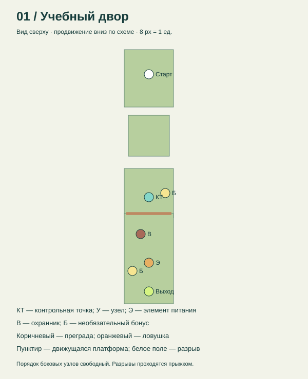
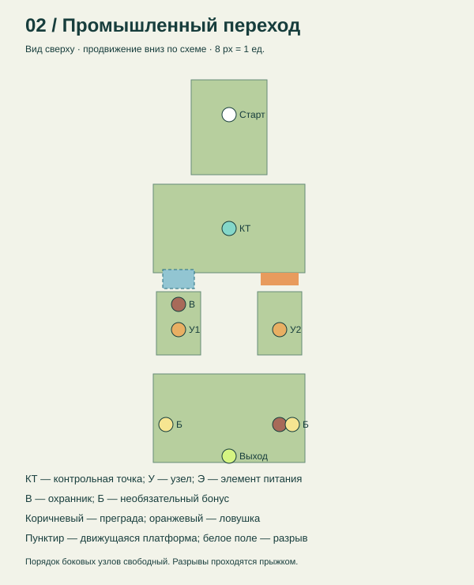
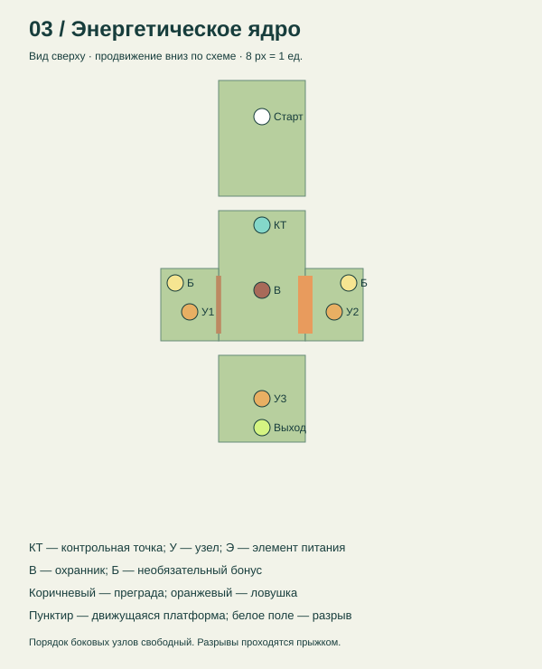

# Кейс №3. Разработка игровых уровней

## Основа работы и фактический объём

За основу принят существующий проект «Носорог — Возвращение энергии» (rhino-energy), подтверждённый пользователем 9 ноября 2026 года. Это браузерный 3D-платформер: JavaScript, Three.js 0.160.0, WebGL, локальные зависимости. Сохранены существующий человекоподобный персонаж с процедурной анимацией, геометрические ассеты, палитра и три сцены. Orbital Limit не использовался.

Три уровня, схемы, механики и первоначальные тесты уже имелись в версии 1.0.0. В текущей работе выполнены аудит, точечные исправления, сюжетные переходы, расширение и повторный запуск проверок. Нельзя представлять существовавшие уровни как заново созданные 9 ноября.

## Концепция и стиль

Город лишился энергии. Носорог находит первый элемент питания, восстанавливает промышленный переход и запускает энергетическое ядро. Цель каждого этапа отображается в интерфейсе; между этапами показываются сюжетные сообщения, финал сообщает о восстановлении города.

Визуальный стиль — условный low-poly: парящие острова, приглушённые зелёные поверхности, геометрический персонаж, направленный свет и тени, туман и светящиеся маркеры. Бирюзовый маркер обозначает контрольную точку, оранжевый — энергию или узел, зелёный — выход. Геометрия, освещение и синтезированные сигналы используются вместо внешних текстур и аудиозаписей. Полноценных диалогов и постановочных кат-сцен нет.

## Три игровых уровня

| Уровень | Цель и сцена | Механики и маршрут | Баланс |
|---|---|---|---|
| 1. Учебный двор | Собрать элемент питания, открыть дальний выход | Линейное обучение: движение → прыжок через разрыв → контрольная точка → рывок через преграду → энергия → выход | Один патруль, два необязательных бонуса; после падения цель сохраняется |
| 2. Промышленный переход | Включить два узла в любом порядке и выйти | Развилка: слева движущаяся платформа, справа циклическая ловушка; затем дальний остров | Два патруля, контрольная точка перед развилкой; разрывы также можно перепрыгнуть |
| 3. Энергетическое ядро | Включить три узла и генератор | Центральный остров, боковые ветви с преградой и ловушкой, дальний узел через разрыв; объединение освоенных действий | Один патруль, три обязательных узла, два необязательных бонуса; финальная активация требует все узлы |

### Схемы уровней

Это схемы существующей реализации, проверяемые по координатам из game.js; они не выдаются за предварительные наброски, созданные до разработки. Масштаб — 8 пикселей на игровую единицу. На схемах показаны платформы, разрывы, противники, преграды, цели, бонусы, старт, выход и контрольные точки. Последовательность маршрута описана в таблице выше.

## Реализация

Сцены задаются тремя записями LEVELS в game.js и собираются функцией buildLevel. Отдельные файлы сцен движка не используются. Персонаж ходит и прыгает, рывком разрушает преграды и обезвреживает патрули. Узлы активируются клавишей E. При потере трёх единиц здоровья или падении герой возвращается к контрольной точке. Сохранения в localStorage содержат цели, разрушенные преграды, бонусы и контрольную точку.

Параметры существующего баланса: скорость движения 6 ед./с, рывка 17 ед./с, длительность рывка 0,22 с, восстановление 0,9 с; начальная вертикальная скорость прыжка 10 ед./с, гравитация 24 ед./с². Номинальная дальность прыжка на ровную поверхность — около 5 ед.; все три маршрута дополнительно проверяются реальным клавиатурным прохождением.

## Доработки 9 ноября 2026 года

- Остановлено мировое время на паузе: фаза ловушек и движение платформ после продолжения согласованы с замороженным состоянием.
- Удалено ошибочное указание искать отсутствующий подъёмник на втором уровне; подсказка ведёт к фактическому выходу.
- Добавлены сюжетные сообщения после первого и второго уровней.
- Схемы сдвинуты ниже заголовков для устранения наложения.
- Исправлены пути сохранения тестовых отчётов; усилены проверки здоровья и паузы.
- Добавлены проверки переноса платформой, столкновения с ловушкой, блокирования стеной и запуска без интернета.

## Тестирование и материалы

См. [протокол](../tests/ПРОТОКОЛ.md), [основные результаты](../tests/results.json), [дополнительные результаты](../tests/additional-results.json), [маршрут](../tests/keyboard-route.json). Снимки работающих сцен и видео прохождения находятся в screenshots/. Автотесты отдельных механик используют диагностическое позиционирование. Сквозной маршрут использует только клавиатурные события и чтение состояния.

## Ограничения

Проверки на физических телефонах, независимые пользовательские испытания, измерение производительности на целевом компьютере и подтверждение руководителя не выполнены. Сложность оценена по устройству уровней и автоматическому прохождению; пользовательский баланс требует отдельных испытаний. Целевые 60 кадров/с не заявляются как достигнутые. Проект является учебным прототипом.
